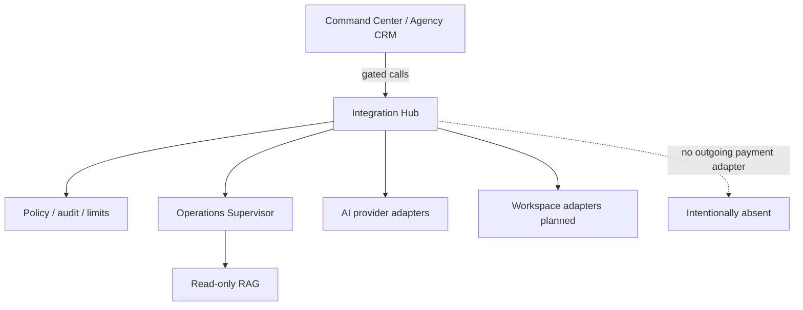

# CodeMatrix Integration Hub

Private policy and orchestration gateway between CodeMatrix systems, Google Workspace, business services, and interchangeable AI providers.

## Problem / What it does

A consulting/ops stack needs a controlled boundary for AI calls, external integrations, audit, and workflow supervision — without exposing secrets or allowing unsafe money movement. The Integration Hub is a FastAPI service that enforces policy, limits, audit metadata, provider adapters, and an Operations Supervisor, with a deliberate **deny-by-design** rule against outgoing payments.

## Key features

- Private FastAPI service with health endpoint
- Synthetic/mock AI provider for tests; OpenAI-compatible provider adapter shape for approved endpoints
- Strict external-data policy classes (public vs internal/redacted vs confidential)
- Request size, timeout, and concurrency limits
- Metadata-only audit records
- Inbound-receipt and accounts-payable **analysis** schemas (no payment execution API)
- Operations Supervisor: deterministic policy engine, idempotency/retry/dead-letter/WIP/kill-switch, multi-AI registry+router (mocks by default), read-only RAG adapter with ACL/provenance/injection defense
- Feature flags default **off** (supervisor, real providers, auto-continue)
- Docker image and Terraform module for a Cloud Run target (not applied in-repo)
- Automated tests (pytest) and Ruff lint config

## Tech stack

- **Language:** Python 3.12+
- **API:** FastAPI, Uvicorn, Pydantic Settings, HTTPX
- **Packaging:** Hatchling (`pyproject.toml`)
- **Quality:** pytest, pytest-asyncio, Ruff, pip-audit (dev)
- **Ops:** Dockerfile, Terraform under `infra/`, GitHub workflows folder

## Architecture overview

## My role

Designed and built by Anderson Henrique Gonçalves (CodeMatrix consulting company).

## Status

Prototype / bootstrap (H0 local & synthetic) — real OAuth, production AI keys, and deployment require explicit gates and are not part of the current branch posture.

## Source code

Source code is private. Available for walkthrough on request.

- LinkedIn: https://www.linkedin.com/in/andersonhenriquegoncalves
- GitHub: https://github.com/anderzilla
